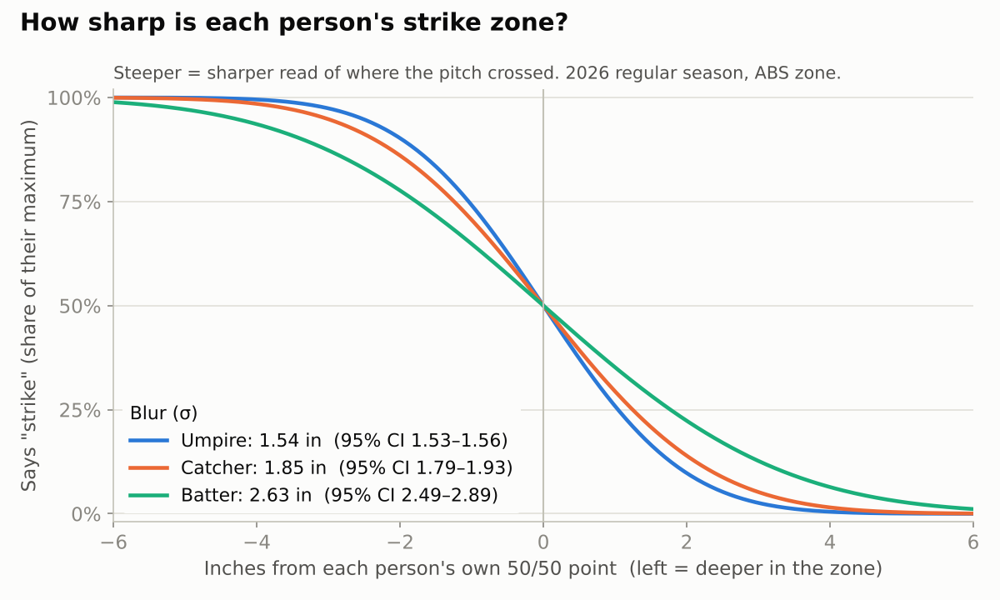
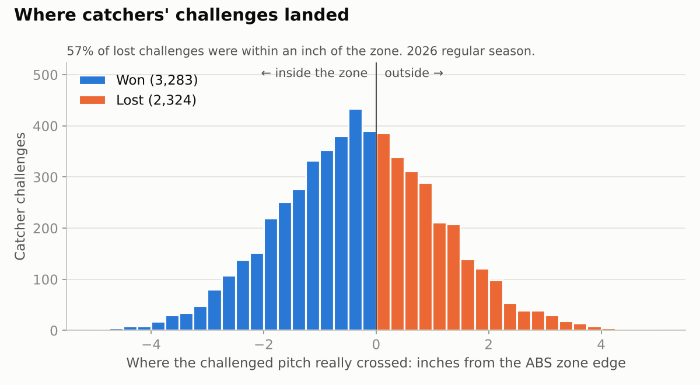

# Umps vs. players: do catchers know the strike zone better than umpires?

2026 was MLB's first season with ABS challenges. Every challenge is a head-to-head:
the umpire made a call, a player said it was wrong, and the ABS system decided.
This repo uses the full 2026 regular season (2,429 games, 371,581 called pitches,
10,545 challenges) to ask whether catchers read the zone better than umpires.

## Short answer

**Head-to-head, catchers win. But that's not because they see the zone better.**

| Challenger | Calls they can challenge | Challenges | Won | Win rate (95% CI) |
|---|---|---:|---:|---|
| Catcher | Balls | 5,607 | 3,283 | **58.6%** (57.3–59.8) |
| Batter | Strikes | 4,759 | 2,327 | 48.9% (47.5–50.3) |
| Pitcher | Balls | 179 | 71 | 39.7% (32.8–47.0) |

When a catcher disputes a ball call, they're right about 3 times in 5. But a
catcher usually waits until a pitch looked about 1.5 inches inside the zone
before challenging, while the umpire has to call every pitch. Measuring how sharply each person
reads where the pitch crossed, umpires come out at least as sharp as catchers, and
both are much sharper than batters:



| Whose read | Blur, σ (95% CI) |
|---|---|
| Umpire (calling strikes) | **1.54 in** (1.53–1.56) |
| Catcher (deciding to challenge a ball call) | **1.85 in** (1.79–1.93) |
| Batter (deciding to challenge a strike call) | **2.63 in** (2.49–2.89) |

## How it works

### 1. Rebuilding the ABS call for every pitch

Statcast's 2026 `plate_x`/`plate_z` are measured at the middle of the plate, the
plane where ABS judges a pitch. Its `sz_top`/`sz_bot` are each batter's ABS zone
(53.5% and 27% of measured height). A pitch is a strike if any part of the ball
touches the 17-inch-wide zone. With a ball radius of 1.45 inches, this rebuilt
zone agrees with **99.95%** of the 10,545 actual ABS rulings, so it's trustworthy
for every taken pitch, challenged or not.

Against that zone, umpires got **93.5%** of calls right in 2026: 95.6% of ball
calls and 88.7% of strike calls. Within an inch of the edge, they got 62.7% right.

### 2. Catchers aren't guessing

At the same distance from the edge, a challenge picked at random would win only
as often as the umpire is wrong there. Catchers do far better than that:

| Distance from zone edge | Ball calls that were really strikes | Catcher challenge win rate |
|---|---:|---:|
| 0–0.5 in | 43% | 53% |
| 0.5–1 in | 30% | 55% |
| 1–2 in | 15% | 61% |
| 2–3 in | 5% | 67% |

So catchers have a real read on close pitches. The question is whether it's
sharper than the umpire's.

### 3. Measuring sharpness

For each person, I fit how often they say "strike" as a function of where the
pitch really crossed (a psychometric curve):

- **Umpire:** how often they call a strike.
- **Catcher:** how often they challenge a ball call, on ball calls where their
  team still had a challenge.
- **Batter:** how often they challenge a strike call, on the same basis.

The fit gives each person a **blur** (σ, in inches): how far off their read of
the pitch's location typically is. The fit also allows for a ceiling, because
catchers sometimes skip a challenge even on an obvious miss. Confidence intervals
come from resampling whole games.

Catchers' blur is about 20% larger than umpires'. A catcher's threshold moves with
the game situation much more than an umpire's does, and mixing thresholds makes a
curve look blurrier. But comparing like with like doesn't flip the result:

| | Umpire σ | Catcher σ |
|---|---|---|
| 2-strike or 3-ball counts | 1.57 (1.53–1.60) | 1.73 (1.63–1.83) |
| Other counts | 1.54 (1.52–1.56) | 1.83 (1.72–1.91) |
| Sides of the zone | 1.45 (1.42–1.46) | 1.65 (1.55–1.78) |
| Bottom of the zone | 1.60 (1.58–1.63) | 1.73 (1.63–1.85) |
| Top of the zone | 1.72 (1.69–1.76) | **2.39** (2.17–2.58) |

The top of the zone is catchers' weak spot. They win 53.6% of challenges there,
against 59.6% on the sides and at the bottom. Top-of-zone pitches are 18% of their
challenges but 36% of their badly wrong ones (2+ inches outside). That fits
catchers still carrying the old, taller zone: ABS puts the top lower than umpires
traditionally called it.

### 4. The catch: shared misreads

We only see a catcher's read on pitches the umpire called balls. The catcher
watches from almost the same spot, so if a pitch fooled the umpire it may also
have fooled the catcher. That would make catchers look blurrier than they are.
Refitting the catcher's blur under a model where the two misreads are correlated:

| Correlation between umpire's and catcher's misreads | Catcher σ |
|---|---|
| 0 (independent) | 1.85 in |
| 0.2 | 1.70 in |
| 0.4 | 1.56 in (equal to the umpire) |
| 0.6 | 1.45 in |

The data fit best with little correlation, but this is only weakly pinned down.
The safe conclusion is that **catchers read the zone no better than umpires.**
They'd come out ahead only if most of what fools the umpire also fools them.

Another way to see it: put an umpire-quality eye in the catcher's crouch, give it
the same 5,607 challenges and the same habit of passing on some obvious misses,
and it would win about **65%** of the time, versus catchers' actual 58.6%. This
assumes independent misreads, as above.

### 5. Win rate measures strategy as well as eyesight

- **By inning:** catchers win 67% of challenges in innings 1–3, 59% in 4–6, 51%
  in 7–9 and 47% in extras. Late in games they take more chances.
- **By count:** they win 69% at 0-1 but 45% at 3-2, where ball four is on the line.
- **Calls left alone:** umpires called 11,197 balls that ABS says were strikes.
  Of the 10,442 that came while the defense still had a challenge, catchers
  challenged 31%. Even among misses of 2+ inches, the defense challenged only 60%.
- **Picky vs. aggressive:** J.T. Realmuto won 70 of 86 (81%) but challenged only
  26% of the umpire's misses against his team. Victor Caratini won 59% while
  challenging 49% of them. Across catchers with 75+ challenges, win rate has
  essentially no relationship to how many of those misses they challenge
  (correlation 0.05).

Full per-catcher numbers are in [`results/catchers.csv`](results/catchers.csv).



## Caveats

- The blur comparison assumes each person's misread is roughly normal and their
  threshold is steady within a situation. Varying thresholds inflate blur, which
  is why the table above also compares within count groups.
- Batters' and catchers' curves come from challenge decisions, which also depend
  on the count, the inning and challenges left. The umpire's comes from every call.
- One season is plenty for league-wide conclusions; the intervals above are tight.
  It's not enough for individual catchers: 80–185 challenges still leaves a lot of
  noise in any one catcher's win rate.
- 13 of 10,558 challenges couldn't be matched to a called pitch in Statcast, and
  198 called pitches have no tracked location. Both are excluded.

## Reproduce

```bash
python -m venv .venv && .venv/bin/pip install -r requirements.txt
.venv/bin/python fetch_statcast.py     # ~720k pitches from Baseball Savant -> data/raw/
.venv/bin/python fetch_challenges.py   # every challenge from the MLB Stats API -> data/
.venv/bin/python analyze.py            # tables -> results/*.csv, results/summary.json
.venv/bin/python charts.py             # charts -> results/*.png
.venv/bin/python zone_viz.py           # zone heat maps page -> site/who-knows-the-zone.html
```

`site/who-knows-the-zone.html` is a self-contained page (open it in a browser)
with zone heat maps of where umpires call strikes and where catchers challenge,
every catcher challenge and every missed strike plotted on the zone, and the
win-rate benchmark described above.

`fetch_challenges.py` captures challenges recorded in two places in MLB's game
feed: on the pitch itself, and on the play when the challenged pitch ended the
plate appearance (a strikeout or walk). The second kind is about a quarter of all
challenges.
